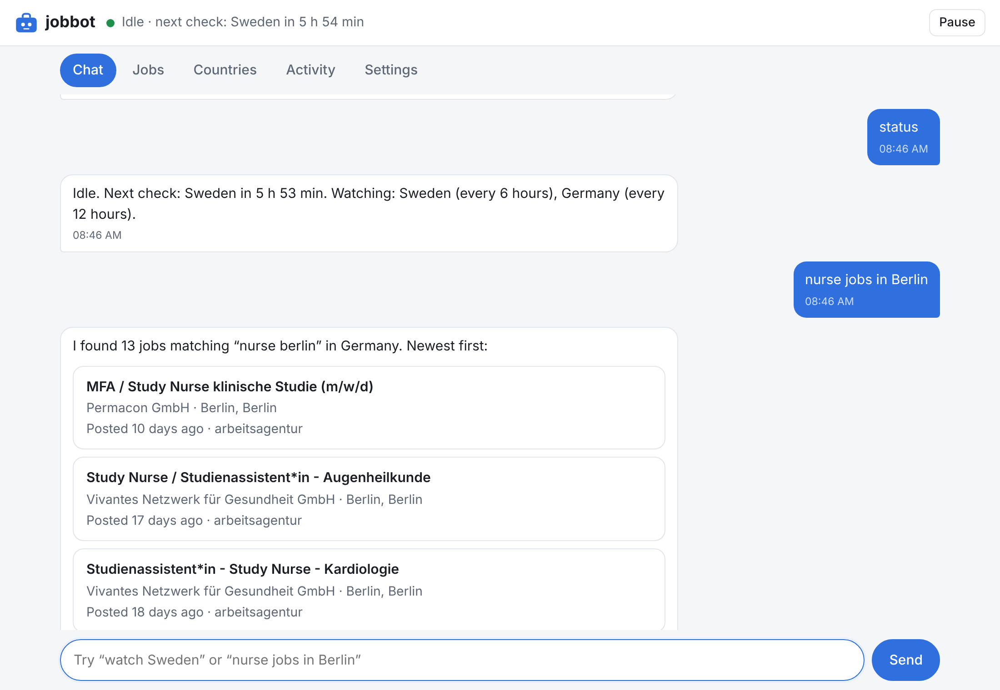

# jobbot

An always-on bot that collects the job openings in the countries you choose,
keeps them up to date, and comes with a web app where you talk to it.



- **Chat with the bot.** Say “watch Sweden”, “nurse jobs in Berlin”, “new remote
  jobs in Germany”, “check Sweden now”, “status” or “stop watching Germany”.
- **It runs around the clock.** It checks each watched country on its own
  schedule (every hour to every 2 days). After the first full download it
  fetches only what changed, and it closes jobs that were taken down.
- **Browse and search** every stored job. Filter by country, work mode,
  posting date or only new openings, open the full listing, export CSV.
- **Get notified.** New openings can go to Slack or Discord after every check.

## Start it

### With Docker (best for running it all the time)

```bash
docker compose up -d
```

Open <http://localhost:8080>. The bot restarts on its own after a crash or a
reboot, and the job database is kept in a Docker volume. To update it later,
run `git pull && docker compose up -d --build`.

### Without Docker

Python 3.11 or newer:

```bash
pip install -e .
jobbot serve            # then open http://localhost:8080
```

The bot works while this command runs. Stop it with Ctrl+C. The data stays
in `jobbot.db`, so it picks up where it left off.

### Where to run it

The bot only checks for jobs while it runs, so run it on a machine that stays on:
a home computer, a Raspberry Pi, or a small cloud server.

By default only that machine can open the app. To use it from your phone or
another computer, protect it with a password first:

```bash
JOBBOT_PASSWORD='pick-a-long-password' jobbot serve --host 0.0.0.0
```

With Docker, put `JOBBOT_PASSWORD=...` in a `.env` file next to
`docker-compose.yml` and change its port line to `"8080:8080"`. If the app can
be reached from the internet, put it behind HTTPS too (for example a reverse
proxy such as Caddy, or a tunnel service).

## Using the app

| Tab | What it's for |
| --- | --- |
| **Chat** | Tell the bot what to do and ask for jobs. Say “help” for examples. |
| **Jobs** | Search everything stored. Click a job for details and a link to the listing. |
| **Countries** | Watch a country, change how often it is checked, check now, pause, stop watching. Shows live progress. |
| **Activity** | What the bot did and every check it ran. |
| **Settings** | API keys, company career sites, extra place names, Slack/Discord webhook. |

The header always shows what the bot is doing, with **Pause** (stop
scheduled checks) and **Stop check** (end the current check early; jobs found
so far are kept).

Things the chat understands:

| You say | The bot |
| --- | --- |
| `watch Sweden`, `track Germany every 12 hours`, `follow nz daily` | starts watching, and checks right away |
| `stop watching Germany` | stops; stored jobs stay searchable |
| `check Sweden now`, `refresh everything` | runs a check immediately |
| `nurse jobs in Berlin`, `remote python jobs`, `new jobs in Sweden`, `jobs posted today in Germany` | searches; a city implies its country |
| `status`, `how many jobs?`, `what countries are you watching?` | reports |
| `sources for New Zealand` | says what a country needs (API key, company boards) |
| `pause`, `resume`, `cancel the current check` | controls the bot |

The chat follows simple rules (keywords, country and city names) and needs no
AI service, so it costs nothing to run.

## Which countries, and how complete?

No single API lists every job in a country, so jobbot combines several kinds
of source. It removes listings that appear on more than one source, and it
tells you when a check could not reach everything.

| Source | Countries | What it covers | Key |
| --- | --- | --- | --- |
| `jobtech` | Sweden | Every ad on Platsbanken, the public employment service's board (~45k) | none |
| `arbeitsagentur` | Germany | The Federal Employment Agency's board (~760k jobs in Germany) | none |
| `adzuna` | AT AU BE BR CA CH DE ES FR GB IN IT MX NL NZ PL SG US ZA | A search engine that aggregates most job boards in each country | free |
| `usajobs` | US | US federal government jobs | free |
| `greenhouse`, `lever`, `ashby`, `smartrecruiters` | any | Career sites of the companies you list | none |

* **Sweden and Germany** work out of the box and are close to complete: they
  are the national public job boards. The first check downloads everything,
  about 15 minutes for each. Later checks take seconds to a minute.
* **Adzuna** is the broadest source for the other 17 countries. Free keys have
  a daily request limit (around 250 requests, or 12,500 listings, when this was
  written), so a large country fills in over several checks, newest first. Add
  the key in **Settings**, and raise the request budget there if Adzuna gives
  you a higher limit.
* **Company boards** add employers' own postings in any country. List the
  companies in **Settings**.

Sites such as LinkedIn, Indeed and SEEK have no public job-search API and
forbid scraping, so jobbot does not use them.

## Command line

Everything the app does also works from a terminal, which is handy for
scripts and cron jobs:

```bash
jobbot sources --country nz                   # what covers a country, and what it still needs
jobbot fetch --country de                     # one check: crawl, store in ./jobbot.db, print a summary
jobbot fetch --country nz --out nz.csv        # ...and export the open jobs
jobbot fetch --country se --since-days 1      # only jobs posted or changed in the last day
jobbot export --country de --out de.jsonl     # export without crawling (csv, json or jsonl)
jobbot watch --country se --every 6h --webhook https://hooks.slack.com/services/...
jobbot stats                                  # what is stored, and recent checks
```

`--country` takes a code (`nz`, `GB`) or a name (`"New Zealand"`, `UK`). On the
command line, API keys come from environment variables (`ADZUNA_APP_ID`,
`ADZUNA_APP_KEY`, `USAJOBS_API_KEY`, `USAJOBS_EMAIL`), and company boards and
other options from `jobbot.toml` (copy [`jobbot.example.toml`](jobbot.example.toml)).
The app copies `jobbot.toml` into its settings the first time it starts.

```console
$ jobbot fetch --country sweden
Sweden (SE) — finished in 13m 16s

  source           mode         status       found       new   closed  requests
  jobtech          full         ok          44,596    44,596        0         1

Open jobs stored for Sweden: 44,596 (44,596 unique across sources)

$ jobbot fetch --country sweden        # later: only what changed
Sweden (SE) — finished in 0m 01s

  source           mode         status       found       new   closed  requests
  jobtech          incremental  ok              41         2        1         1

Open jobs stored for Sweden: 44,597 (44,597 unique across sources)

New since the last run: 2
  • Butiksmedarbetare Gottis — Amoude AB (Uppsala, Uppsala län) https://arbetsformedlingen.se/platsbanken/annonser/31784275
  • Dynamics 365 CE Functional Analyst — Avanade Sweden AB (Stockholm, Stockholms län) https://arbetsformedlingen.se/platsbanken/annonser/31784227
```

## How it works

* **First check of a source:** a full download of everything it lists. Those
  jobs are the starting point, so they are not reported as “new”.
* **Later checks:** only what changed since the last successful check, where
  the source supports that. Germany, Adzuna and USAJOBS do a full check again
  every 7 days, because their change feeds don't report removed jobs. Company
  boards are always read in full.
* **Closing jobs:** a job is marked closed when its source reports it removed,
  or when a complete full check no longer lists it. Checks that stop early
  (request budget, errors, Stop check) never close anything. A closed job that
  reappears is reopened.
* **Duplicates:** the same title, company and place on two sources counts
  once; the `sources` column lists where it appeared.
* **Germany:** one query to the federal board can only page through 10,000
  results. jobbot splits the search into slices (by occupational field, temp
  agency, contract type and private agency, then overlapping 150 km circles
  around cities) until each slice fits, and reports how many listings it
  reached. Jobs the board lists abroad are left out.
* **Sweden:** the first check downloads the full snapshot of published ads,
  about half a gigabyte. Later checks read the change feed, which also reports
  removed ads.
* **The app** (`jobbot serve`) is a FastAPI server. It runs the bot in a
  background thread, keeps everything in one SQLite file, and serves a
  single-page interface with no build step. The JSON API is described at
  `/api/docs`.

### Exported columns

`country, title, company, location, city, region, work_mode, employment_type,
category, salary_min, salary_max, salary_currency, salary_period, salary_text,
posted_at, expires_at, url, source, source_id, sources, first_seen, last_seen,
closed_at, description`

Fields a source does not provide are left empty. The German board and
SmartRecruiters give no description in their listings, and Swedish and German
listings use the language of the original ad.

### Known limits

* Greenhouse boards give free-text locations, such as "Remote, US" or
  "London, ON". jobbot reads them with a list of country names, states,
  provinces and major cities. A posting that names only a small town can be
  missed: add such places under **Extra place names** in Settings.
* A remote job open to a whole region ("Remote – EMEA") is not counted for
  each country in that region.
* The Adzuna and USAJOBS sources follow those APIs' published formats but have
  not yet been run against the live services. The keyless sources have.
* API keys saved in the app are stored unencrypted in the database file, on
  the machine that runs the bot.

## Development

```bash
pip install -e '.[test]'
pytest
```

To add a source, subclass `jobbot.sources.base.Source`, implement
`fetch(country, ctx)` so it yields `Job` objects (and `Removed` for postings a
change feed reports deleted), then add it to `ALL_SOURCES` in
`jobbot/sources/__init__.py`. The app code lives in `jobbot/app/`: `bot.py`
(the scheduler), `chat.py` (what the chat understands), `server.py` (the API)
and `static/` (the interface).
